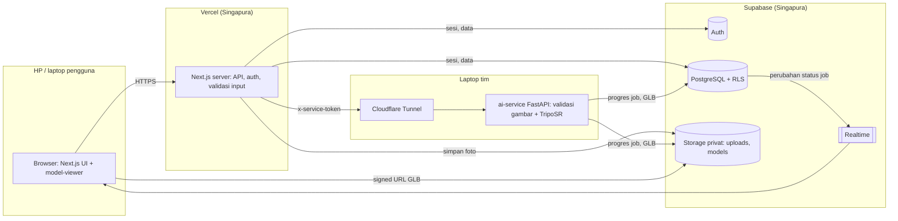

# AR-LOKAL

**Satu foto produk UMKM jadi model 3D yang bisa ditaruh di ruangan pembeli lewat AR.**

| | |
|---|---|
| Kompetisi | LOGICODIX 2026 Hackathon Competition |
| Kategori | **Web** |
| Subtema | Local MSME & Creative Economy |
| Nama tim | **[ISI NAMA TIM]** |
| Anggota | Apriansyah Sitompul (0920250058) · Ilfaj Al-Nur (0920250067) · Muhammad Bintang Basev Al-Qard (0920250070) · Syalwa Insani (0920250080) |
| Aplikasi | https://login-masuk.vercel.app |
| Video demo | [ISI LINK YOUTUBE] |

> Model 3D adalah **perkiraan AI**. Satu foto tidak bisa memperlihatkan sisi belakang produk, dan ukuran nyata hanya akurat bila penjual mengisinya.

---

## Masalah

Pelaku UMKM aksesori fesyen dan kerajinan tangan (tas, sepatu, perhiasan, keramik, vas, kerajinan rotan/bambu/kayu) menjual produknya hanya dengan foto dua dimensi. Foto tidak memperlihatkan bentuk utuh dan ukuran produk, sehingga calon pembeli ragu. Membuat model 3D atau pengalaman AR biasanya butuh studio, perangkat lunak berbayar, atau jasa desainer yang tidak terjangkau UMKM.

## Solusi

AR-LOKAL adalah aplikasi web yang:
1. menerima **satu foto produk** dari penjual,
2. **memeriksa foto dengan AI** (ketajaman, cahaya, jumlah benda, keberadaan orang/hewan, produk terpotong, kategori),
3. **membangun model 3D** dengan TripoSR,
4. menampilkan model yang bisa diputar, dan **menaruhnya di ruangan nyata lewat AR** di HP dengan ukuran aslinya.

Semua AI berjalan di server sendiri dengan model open-source. Tidak ada layanan AI berbayar.

## Target pengguna

- **Penjual UMKM** aksesori fesyen dan kerajinan yang berjualan online maupun di bazar.
- **Calon pembeli** yang ingin melihat bentuk dan ukuran produk sebelum membeli.

---

## Fitur yang sudah berjalan

| Fitur | Keterangan |
|---|---|
| Akun | Daftar, verifikasi email, masuk/keluar, lupa kata sandi. Peran pengguna dan admin. |
| Studio | Unggah satu foto (JPG/PNG/WEBP, maks. 10 MB), nama produk, ukuran asli opsional, konfirmasi hak atas gambar. |
| Validasi gambar AI | Menolak foto buram, gelap, resolusi rendah, berisi orang/tangan/hewan, lebih dari satu benda, produk terpotong, atau di luar kategori. Setiap penolakan disertai alasan dan saran perbaikan. Gagal aman: bila AI tidak tersedia, tidak ada yang disimpan. |
| Pembuatan model 3D | TripoSR membuat model 3D (GLB) dari foto yang lolos. Progres per tahap tampil langsung (Realtime + polling), bisa dibatalkan dan diulang. Kuota 5 model/hari per pengguna dan antrean maksimal 10. |
| Penampil 3D | Model bisa diputar dan diperbesar, label "Aproksimasi hasil AI", status kualitas, ukuran, unduh GLB. |
| AR "Lihat di ruangan Anda" | WebXR (Chrome Android), Google Scene Viewer, dan Apple Quick Look. Produk ditampilkan dengan ukuran nyata. Tombol hanya muncul di perangkat yang mendukung AR. |
| Ubah ukuran asli | Setelah model jadi, penjual bisa mengisi tinggi/lebar/kedalaman asli. File model diskalakan ulang tanpa dibuat ulang, dan AR ikut menyesuaikan. |
| Riwayat | Semua kiriman, termasuk yang ditolak beserta alasannya, dengan filter dan halaman. Bisa dibuka, dibuat ulang, atau dihapus (beserta filenya). |
| Admin | Ringkasan jumlah pengguna, kiriman, validasi ditolak, dan status layanan AI. |
| Privasi & keamanan | Row Level Security di semua tabel, berkas privat dengan signed URL, rate limit, proteksi CSRF, CSP dengan nonce, metadata EXIF dihapus, setiap kiriman diberi batas simpan 30 hari. |

---

## Teknologi

| Lapisan | Teknologi |
|---|---|
| Frontend & server web | Next.js 16 (App Router, TypeScript), React, Tailwind CSS v4, Zod, sharp, `@supabase/ssr` |
| 3D & AR | `@google/model-viewer` (WebXR, Scene Viewer, Quick Look) |
| Database, Auth, Storage, Realtime | Supabase (PostgreSQL + RLS, GoTrue, Storage, Realtime) |
| Layanan AI | Python, FastAPI, PyTorch, ONNX Runtime, OpenCV, MediaPipe, OpenCLIP, TripoSR, scikit-image, trimesh |
| Hosting | Vercel (frontend, region Singapura), Supabase Cloud (Singapura), layanan AI di laptop tim melalui Cloudflare Tunnel |
| Pengujian | Vitest, Playwright, pytest, Ruff, ESLint, Prettier |

Layanan pihak ketiga yang dipakai: **Supabase**, **Vercel**, **Cloudflare Tunnel** (gratis), **Hugging Face Hub** (hanya untuk mengunduh bobot model sekali).

---

## Arsitektur dan alur data



Alur satu produk:
1. Penjual mengunggah foto di **Studio**. Server Next.js memeriksa jenis berkas dari isinya (bukan ekstensi), menghapus EXIF, lalu mengirim foto ke **ai-service** untuk validasi.
2. ai-service menjalankan ISNet (pemisahan latar), YOLOX (orang/hewan/benda), MediaPipe (tangan/wajah/tubuh), OpenCLIP (kategori), dan OpenCV (ketajaman/cahaya). Hasilnya dikembalikan, lalu foto dan hasil validasi disimpan di Supabase.
3. Bila lolos, penjual menekan **Buat model 3D**. Job masuk antrean di database dan dikirim ke ai-service.
4. ai-service menjalankan TripoSR, membersihkan mesh, menskalakan ke meter, memeriksa kualitas, lalu mengunggah GLB ke Storage dan memperbarui status job per tahap.
5. Browser menerima progres lewat Realtime. Setelah selesai, halaman model memuat GLB melalui signed URL dan menampilkan tombol AR.

---

## Instalasi dan menjalankan aplikasi

### Kebutuhan
- Node.js 22+, Python 3.10–3.12, Git
- Akun Supabase (gratis) dan Vercel (gratis), atau Supabase lokal (Docker + Supabase CLI)
- Laptop/PC untuk layanan AI. GPU NVIDIA disarankan; tanpa GPU tetap bisa memakai mode CPU (diukur ±26 detik per model di laptop tim, RAM 16 GB).

### 1. Database (Supabase)
```bash
npx supabase login
npx supabase link --project-ref <PROJECT_ID>
npx supabase db push --remote          # membuat tabel, RLS, trigger, bucket storage
```
Untuk Supabase lokal: `npx supabase start` lalu `npx supabase db reset`.

### 2. Layanan AI (`ai-service`)
```bash
cd ai-service
python -m venv .venv
.venv\Scripts\activate                 # Windows  (Linux/macOS: source .venv/bin/activate)
pip install -r requirements.txt -r requirements-models.txt -r requirements-reconstruction.txt
python -I scripts/download_models.py   # ISNet, YOLOX, MediaPipe, TripoSR
copy ai.env.example ai.env             # isi nilainya (lihat tabel variabel di bawah)
uvicorn ai_service.app:app --port 8000
```
Di Windows cukup klik dua kali `scripts\start-ai.cmd`: skrip ini membaca `ai-service\ai.env`, menyalakan ai-service dan Cloudflare Tunnel, lalu menampilkan alamat tunnel. **Alamat tunnel berubah setiap kali dinyalakan ulang**, jadi perbarui `AI_SERVICE_URL` di Vercel lalu redeploy.

### 3. Frontend (`frontend`)
```bash
cd frontend
npm ci
copy ..\.env.example .env.local        # isi nilainya
npm run dev                            # http://localhost:3000
```
Deploy ke Vercel: set **Root Directory** = `frontend`, isi variabel lingkungan di bawah, dan pilih **Function Region** yang sama dengan Supabase (misalnya Singapore `sin1`).

### Variabel lingkungan
Contoh lengkap ada di [`.env.example`](.env.example) dan [`ai-service/ai.env.example`](ai-service/ai.env.example).

| Variabel | Dipakai oleh | Keterangan |
|---|---|---|
| `NEXT_PUBLIC_SUPABASE_URL` | frontend | URL project Supabase |
| `NEXT_PUBLIC_SUPABASE_ANON_KEY` | frontend | Publishable/anon key |
| `NEXT_PUBLIC_APP_URL` | frontend | URL aplikasi, misalnya `https://login-masuk.vercel.app` |
| `SUPABASE_SERVICE_ROLE_KEY` | frontend (server saja) | Secret key Supabase, jangan pernah diberi awalan `NEXT_PUBLIC_` |
| `AI_SERVICE_URL` | frontend (server saja) | Alamat ai-service atau tunnel |
| `AI_SERVICE_SECRET` | frontend (server saja) | Minimal 24 karakter, sama dengan `AILOKAL_SERVICE_SECRET` |
| `GENERATION_DAILY_LIMIT`, `GENERATION_QUEUE_CAP`, `RATE_LIMIT_*`, `RETENTION_DAYS` | frontend | Opsional, ada nilai bawaan |
| `AILOKAL_SERVICE_SECRET` | ai-service | Rahasia bersama dengan frontend |
| `AILOKAL_SUPABASE_URL`, `AILOKAL_SUPABASE_SERVICE_KEY` | ai-service | Untuk menyimpan progres job dan berkas GLB |
| `AILOKAL_ALLOW_CPU_RECONSTRUCTION` | ai-service | `true` bila tidak ada GPU NVIDIA |

### Akun demonstrasi
| Peran | Email | Kata sandi |
|---|---|---|
| Pengguna | [ISI EMAIL AKUN DEMO] | [ISI KATA SANDI DEMO] |

Akun demo dibuat khusus untuk juri dan sudah terverifikasi. Pembuatan model 3D membutuhkan layanan AI di laptop tim dalam keadaan menyala; bila sedang mati, aplikasi menampilkan keterangan "Layanan validasi AI sedang tidak tersedia" dan tidak menyimpan apa pun.

### Pengujian
```bash
cd frontend && npm run typecheck && npm run lint && npm test     # 101 unit test
cd ai-service && ruff check . && pytest -q
cd supabase/tests && npm ci && npm test                          # migrasi + RLS
```

---

## Dokumentasi penggunaan AI

### AI di dalam produk
Semua model open-source, berjalan di server sendiri (ai-service), tanpa API berbayar.

| Model | Bagian produk yang memakainya |
|---|---|
| **TripoSR** (Stability AI & VAST, MIT) | Membuat model 3D dari satu foto (halaman progres dan model 3D) |
| **ISNet / DIS** (Apache-2.0) | Memisahkan produk dari latar, menghitung jumlah benda, mendeteksi produk terpotong (validasi di Studio) |
| **YOLOX-s** (Apache-2.0) | Mendeteksi orang, hewan, dan benda lain (validasi) |
| **MediaPipe** hand/face/pose (Apache-2.0) | Mendeteksi tangan, wajah, dan bagian tubuh (validasi) |
| **OpenCLIP ViT-B-32** (MIT) | Mengenali kategori produk (validasi, dan ukuran perkiraan per kategori) |

Batasan yang disampaikan ke pengguna: model adalah perkiraan, sisi belakang produk ditebak AI, warna mode CPU lebih polos, dan foto berisi orang selalu ditolak demi privasi. Rincian ada di halaman **Transparansi AI** di aplikasi.

### AI dalam proses pengembangan
- **Claude (Anthropic)** dipakai sebagai asisten pemrograman untuk menulis dan meninjau sebagian besar kode (frontend, ai-service, migrasi database, pengujian), mendiagnosis error saat instalasi, menyusun dokumentasi ini, dan menyarankan desain antarmuka.
- [ISI BILA ADA ALAT AI LAIN YANG DIPAKAI TIM]

Tim meninjau, menjalankan, menguji, dan bertanggung jawab penuh atas seluruh kode, keamanan, dan fungsi aplikasi, termasuk kode yang dibantu AI.

---

## Atribusi

Daftar lengkap beserta versi dan lisensi ada di [`docs/ATTRIBUTION.md`](docs/ATTRIBUTION.md). Ringkasnya:
- **Kode pihak ketiga yang disertakan:** TripoSR (MIT) di `ai-service/third_party/triposr`, dengan lisensi asli dan catatan perubahan.
- **Bobot model:** TripoSR, ISNet (via rembg), YOLOX-s, MediaPipe, OpenCLIP. Lisensinya ada di tabel di atas.
- **Library:** Next.js, React, Tailwind CSS, Supabase, Zod, sharp, model-viewer, FastAPI, PyTorch, OpenCV, trimesh, dan lainnya (MIT/Apache-2.0/BSD).
- **Font:** Plus Jakarta Sans (Tokotype, SIL OFL 1.1).
- **Motif:** pola batik kawung dibuat sebagai SVG sederhana di `globals.css` (bukan aset pihak ketiga).
- **Data uji:** contoh gambar dari repositori TripoSR (MIT) dan gambar sintetis buatan tim (`ai-service/tests/fixtures/manifest.json`).
- Tidak ada template UI pihak ketiga. AR-LOKAL tidak berafiliasi dengan Shopee atau Tokopedia.

## Keterbatasan
- Satu foto tidak bisa memperlihatkan sisi belakang; bentuk belakang ditebak oleh AI.
- Pakaian, perhiasan mengilap, dan benda transparan sering menghasilkan model yang kurang baik.
- Layanan AI berjalan di laptop tim, jadi pembuatan 3D hanya tersedia saat laptop dan tunnel menyala. Model yang sudah jadi tetap bisa dilihat kapan saja.
- AR membutuhkan HP dengan ARCore (Android) atau ARKit (iPhone/iPad).

Detail teknis lain: [Arsitektur](docs/ARCHITECTURE.md) · [Keamanan](docs/SECURITY.md) · [Keputusan desain](docs/DECISIONS.md) · [Perangkat keras](docs/HARDWARE.md) · [Laporan uji](docs/TEST_REPORT.md)

## Lisensi
Kode proyek: [PILIH LISENSI, misalnya MIT, lalu tambahkan file `LICENSE` di direktori utama]. Lisensi komponen pihak ketiga mengikuti masing-masing pemiliknya (lihat [`docs/ATTRIBUTION.md`](docs/ATTRIBUTION.md)).
